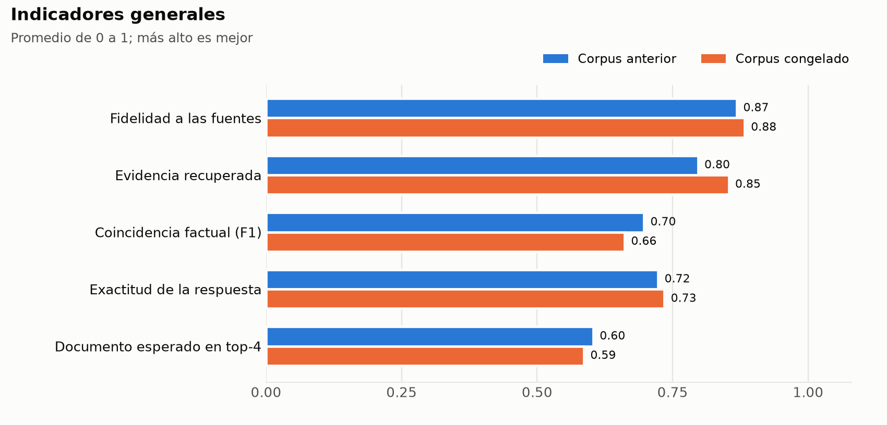

# ATLAS — Orientación normativa y jurisprudencial sobre playas

Sistema agéntico de orientación normativa y jurisprudencial sobre playas en Colombia.

Para consultar o evaluar la colección Gold A, empezar por
[Usar Gold A en ATLAS](rag/docs/DESPLIEGUE.md#usar-gold-a-en-atlas).

## Organización y documentación

| Directorio | Responsabilidad | Documentación |
|---|---|---|
| `rag/` | API, agente, frontend y evaluación | [RAG](rag/README.md) |
| `ingesta/` | Conversión, seccionado y enriquecimiento de documentos | [Ingesta](ingesta/README.md) |
| `vector-infraestructura/` | EC2 de ChromaDB y Ollama | [Infraestructura vectorial](vector-infraestructura/README.md) |
| `rag/infrastructure/` | ECS, ALB, ECR y EFS de la aplicación | [Infraestructura RAG](rag/infrastructure/README.md) |
| `ingesta/infrastructure/` | Bucket S3 de las capas del pipeline | [Scripts de ingesta](ingesta/docs/SCRIPTS.md#infraestructura-responsabilidades) |
| `data/` | Corpus versionado, inventario, campos de Gold y respaldos de ChromaDB | [Corpus y datos](data/README.md) |
| `scripts/` | Herramientas que coordinan varios componentes | [Despliegue desde bastion](rag/infrastructure/README.md#desplegar-desde-un-bastion) |

`rag/` e `ingesta/` son proyectos Python independientes, con sus propios
entornos y locks. El frontend utiliza Bun dentro del workspace de `rag/`.
No se necesita mover carpetas ni compartir un entorno para trabajar en ellos.
Para desarrollo local, empezar por el README del componente. Ver
[CONTRIBUTING.md](CONTRIBUTING.md) para ramas, alcance y controles de cambios.

## Operación en AWS

Los pasos de despliegue, encendido, apagado y respaldo de PostgreSQL están
reunidos en [Infraestructura RAG](rag/infrastructure/README.md).
La [recuperación de Gold A](data/chroma-releases/README.md) describe el
paquete, el perfil de embeddings y la verificación de la colección.

## Evaluación de calidad

La calidad de ATLAS se mide con [RAGAS](https://docs.ragas.io/) contra el ground truth del equipo jurídico. Resultados, informe para el equipo jurídico y registro de evaluaciones: [`rag/evaluation/README.md`](rag/evaluation/README.md#resultados-sobre-el-ground-truth-v02).

**Línea base vigente (corpus congelado, 2026-11-01, infraestructura local):** 52 de 65 respuestas correctas según el juez, fidelidad 0,88, evidencia recuperada 0,85, Factual F1 0,66 y Answer Accuracy 0,73. Frente a la corrida anterior no hay cambios medibles. El punto débil sigue siendo la normativa: REMAC 5 y Decreto 2324 no llegan a los 4 fragmentos en ninguno de 18 casos con la pregunta original. Detalle de la corrida y de la prueba en AWS con Claude en [`rag/evaluation/README.md`](rag/evaluation/README.md#prueba-en-aws-con-claude-no-reemplaza-la-línea-base).

### Qué se hizo en la rama `julian-rincon/evaluacion-ragas-linea-base`

> [!WARNING]
> **Aviso para `main` (registro con tipo de usuario, PR #23):** la columna nueva `users.user_type` no se crea en bases de datos que ya existían, porque `init_db` solo usa `create_all` y este no altera tablas existentes. En esas bases (por ejemplo, la de AWS si ya estaba desplegada) el login, `/api/auth/me` y todos los endpoints autenticados responden 500 con `column users.user_type does not exist`. En esta rama está corregido en `rag/backend/rag/api/database.py` (commit `cd44c4f`, con la prueba `rag/tests/unit/test_init_db_adds_missing_columns.py`). Si la base de AWS ya tiene la columna, no hay impacto.

Rama de trabajo sobre evaluación y recuperación, a partir de la línea base anterior. Todo se midió sobre los 66 casos del ground truth v0.2 con las métricas fijas sin LLM (`evaluation/metricas_sin_llm.py`); las notas del juez RAGAS de la tabla anterior son las de la línea base del 2026-11-01.

1. **Herramientas de evaluación:** ground truth v0.2 desde el Excel del equipo jurídico, métricas fijas sin LLM con IC 95 % y comparación contra la línea base, caché de generación reanudable, RAGAS con gpt-5-nano y registro versionado de cada corrida.
2. **Recuperación** (hasta el 2026-11-21; desde el 26-nov se usa la de `corpus`, ver punto 9) (`core/retriever.py`, `core/territorio.py`): tokenizador español para BM25, fusión RRF c=2 con pesos 0,8 BM25 / 0,2 vectores, varias consultas fusionadas (original, autosuficiente y enriquecida), un fragmento por sentencia, prioridad territorial (no traer normas locales de otra ciudad) y jerarquía normativa (la norma antes que la jurisprudencia).
3. **Respuestas:** el prompt prohíbe nombrar normas que no estén en el contexto y ordena norma → jurisprudencia; las respuestas sin recuperación guían al usuario con ejemplos y con los datos que faltan (lugar, actividad, autoridad).
4. **Gold A corregido** (rama `corpus`, colección `rag_playas_gold_a_cc7bf44b54a9`) fusionado en la rama.
5. **QA y carga:** ~6.000 peticiones sin LLM (hasta 200 simultáneas) sin errores 5xx, validación y entradas hostiles correctas, y corrección de un agotamiento del pool de conexiones que producía 500 con más de 15 consultas simultáneas.
6. **`main` al día (2026-11-12):** se fusionó el registro con tipo de usuario y, al hacerlo, se corrigió que la columna nueva `users.user_type` no se creaba en bases ya existentes (login y endpoints autenticados daban 500); `init_db` ahora agrega las columnas opcionales que falten. Verificado con el sistema completo (base existente, registro, login, consultas y QA con LLM sin errores 500); 1066 pruebas de backend y 245 de frontend en verde.
7. **Resolución documental de `corpus` integrada (2026-11-16):** se fusionaron los commits de `corpus` del 2026-11-15 y 16, hasta `3260bba` (respuestas verificadas a «¿qué ordenó/resolvió/decidió en … instancia … en el radicado …?», preguntas «según el REMAC 5» , aclaración de radicados parciales, plazos y remisiones citados, citas conservadas en JSON/SSE). Conviven con la recuperación multiconsulta de esta rama: con radicado verificado se usa la selección verificada de `corpus`; el resto de preguntas, la búsqueda fusionada. Con la resolución apagada la recuperación queda idéntica (0,741, fuga 0); encendida, 6 de 8 preguntas de radicado reales reciben la decisión citada textualmente y los 2 controles se rechazan (antes, las 8 terminaban en «fuera del ámbito»). La infraestructura conserva `register_enabled` y `legal_resolution_enabled`. Una prueba de contrato protege las funciones del RAG que usan la ingesta y la evaluación de nivel 0. 1338 pruebas de backend y 245 de frontend en verde. El 2026-11-19 se integró `corpus` hasta `b4346fc` (consultas a Chroma acotadas, borrado concurrente seguro y embeddings cancelables): 1402 pruebas de backend.
8. **`corpus` hasta `5665e4f` y mantenimiento adaptativo (2026-11-21):** se integró el contexto normativo verificado de `corpus` (admisión normativa, aclaraciones, citas por norma, sesiones, cierre SSE) sin perder la multiconsulta ni la jerarquía normativa. Para que el próximo update no obligue a re-afinar a mano: los parámetros de recuperación se leen del entorno con los valores medidos por defecto, las listas fijas se contrastan con la capa gold en las pruebas (lugares de las normas locales, tipo de cada documento esperado), las métricas sin LLM guardan la colección y los parámetros con que se midieron y comparan «antes» contra «después», y `scripts/integrar_corpus.sh` hace todo el ciclo. Python fijado en 3.12 (como CI), la multiconsulta queda en las trazas igual que `ainvoke`, y las pruebas ya no fallan si la ruta del repo tiene espacios. 1679 pruebas de backend, 322 de frontend y 1360 de ingesta en verde; métricas idénticas a las del 19-nov.

9. **`corpus` hasta `6d868f2` con su RAG tal cual (2026-11-26):** por decisión del equipo, en los conflictos manda `corpus` y esta rama se adapta. Se toman su `agent.py`, `retriever.py`, prompts y configuración; salen de la rama la multiconsulta, la prioridad territorial, la jerarquía normativa, el tope por sentencia y por norma, el tokenizador español de BM25 y el saludo guiado, con sus pruebas. Ese retriever queda en el historial (`11e3cef`) como propuesta con sus números. La evaluación se adaptó: `metricas_sin_llm.py` mide la ruta `_multi` como la consulta compuesta del grafo de `corpus` (`_compose_retrieval_query`), el detector de territorio pasa a `evaluation/territorio.py` (solo mide, no cambia la recuperación) y se congelan las secciones del prompt anterior para seguir detectando fugas en la caché de la línea base. `corpus` ya incluye nuestro ground truth v0.2 y el set de 40 preguntas reales sin cambios; su `evaluation/api_capture.py` (captura JSON/SSE) cubre lo mismo que nuestro `preguntas_reales.py`. Medido sin LLM con la colección `rag_playas_gold_a_cc7bf44b54a9`: documento esperado en el top-4 0,741 → **0,586**, por la ruta compuesta del grafo 0,534.

| Indicador (66 casos) | Línea base 2026-11-01 | Rama hasta 2026-11-21 (`11e3cef`) |
|---|---:|---:|
| Documento esperado en el top-4 de la búsqueda | 0,586 | **0,741** |
| Documento esperado en los fragmentos que llegan al modelo | 0,53 | **0,75–0,79** |
| Normativa en el top-4 con la pregunta original | 0 de 18 | **8 de 18** |
| Fuga territorial (norma local de otra ciudad) | 0,045 | **0** |
| Respuestas con referencias sin respaldo (generador Claude) | 12,3 % | **3,1 %** |

> **Desde el 2026-11-26 la rama usa el RAG de `corpus` tal cual** (ver punto 9 del README raíz). La columna de la derecha es la de nuestro retriever hasta `11e3cef`; con el de `corpus`, el documento esperado en el top-4 vuelve a **0,586** (fuga territorial 0,045, normativa 0 de 18), igual que la línea base.

- **Gold A corregido:** con el mismo código y el mismo modelo, la búsqueda da exactamente lo mismo que con el Gold anterior; las respuestas cambian dentro del ruido del modelo local.
- **k=6 frente a k=4:** más evidencia hacia el modelo (0,754 → 0,786; artículos esperados 0,147 → 0,206) y, con Claude como generador y juez, 16 respuestas correctas frente a 11. El valor por defecto sigue en k=4.
- **Sigue débil:** multas y sanciones responden «evidencia insuficiente» por falta de cobertura en el corpus.

#### Cómo correr todo e integrar el próximo update de `corpus`

```bash
# Desde la rama de integración, con el árbol limpio.
# ChromaDB local con el Gold A y Ollama de embeddings (las métricas se omiten si no responden):
export CHROMA_HOST=localhost CHROMA_PORT=8001 OLLAMA_BASE_URL=http://localhost:11434
scripts/integrar_corpus.sh                   # fetch + merge de origin/corpus, pruebas y métricas antes/después
scripts/integrar_corpus.sh --solo-verificar  # sin merge: rag, frontend, ingesta y métricas
```

El script guarda la rama en `respaldo-local/integracion-antes-corpus-<fecha>`, lista los archivos que tocan ambos lados, se detiene ante conflictos, corre rag (ruff, formato, mypy, pytest), frontend (lint, tsc, vitest, build) e ingesta (ruff, pytest, contratos), y compara las métricas sin LLM de antes y después en la misma sesión de ChromaDB. Sale con 1 si algo falla o hay una regresión. No hace push ni toca `main` ni `corpus`. Los registros quedan en `rag/evaluation/results/integracion-<fecha>-<commit>/`.

Parámetros de recuperación (opcionales; sin definir valen lo medido): `RAG_RRF_C=2`, `RAG_BM25_WEIGHT=0.8`, `RAG_VECTOR_WEIGHT=0.2`, `RAG_CUPOS_NORMATIVA=1`, `RAG_FRAGMENTOS_POR_SENTENCIA=1`, `RAG_FRAGMENTOS_POR_NORMA=1` (0 = sin tope). Para re-medir uno tras un update: `RAG_CUPOS_NORMATIVA=2 uv run python -m evaluation.metricas_sin_llm --tag cupos2` desde `rag/`.

Registro completo del trabajo (cronología, cambios por componente, decisiones y verificación): [`rag/docs/TRABAJO_RAMA_EVALUACION.md`](rag/docs/TRABAJO_RAMA_EVALUACION.md). Cifras, condiciones y comandos de cada medición: [`rag/evaluation/README.md`](rag/evaluation/README.md#estado-al-2026-11-11-gold-a-corregido-mejoras-de-recuperación-y-qa-sin-juez). Arquitectura actual: [`rag/docs/ARCHITECTURE.md`](rag/docs/ARCHITECTURE.md).



