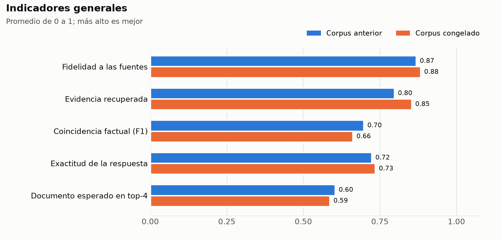

# ATLAS — Orientación normativa y jurisprudencial sobre playas

Sistema agéntico de orientación normativa y jurisprudencial sobre playas en Colombia.

Para consultar o evaluar la colección Gold A, empezar por
[Usar Gold A en ATLAS](rag/docs/DESPLIEGUE.md#usar-gold-a-en-atlas).

## Organización y documentación

| Directorio | Responsabilidad | Documentación |
|---|---|---|
| `rag/` | API, agente, frontend y evaluación | [RAG](rag/README.md) |
| `ingesta/` | Conversión, seccionado y enriquecimiento de documentos | [Ingesta](ingesta/README.md) |
| `vector-infraestructura/` | EC2 de ChromaDB y Ollama | [Infraestructura vectorial](vector-infraestructura/README.md) |
| `rag/infrastructure/` | ECS, ALB, ECR y EFS de la aplicación | [Infraestructura RAG](rag/infrastructure/README.md) |
| `ingesta/infrastructure/` | Bucket S3 de las capas del pipeline | [Scripts de ingesta](ingesta/docs/SCRIPTS.md#infraestructura-responsabilidades) |
| `data/` | Corpus versionado, inventario, campos de Gold y respaldos de ChromaDB | [Corpus y datos](data/README.md) |
| `scripts/` | Herramientas que coordinan varios componentes | [Despliegue desde bastion](rag/infrastructure/README.md#desplegar-desde-un-bastion) |

`rag/` e `ingesta/` son proyectos Python independientes, con sus propios
entornos y locks. El frontend utiliza Bun dentro del workspace de `rag/`.
No se necesita mover carpetas ni compartir un entorno para trabajar en ellos.
Para desarrollo local, empezar por el README del componente. Ver
[CONTRIBUTING.md](CONTRIBUTING.md) para ramas, alcance y controles de cambios.

## Operación en AWS

Los pasos de despliegue, encendido, apagado y respaldo de PostgreSQL están
reunidos en [Infraestructura RAG](rag/infrastructure/README.md).
La [recuperación de Gold A](data/chroma-releases/README.md) describe el
paquete, el perfil de embeddings y la verificación de la colección.

## Evaluación de calidad

La calidad de ATLAS se mide con [RAGAS](https://docs.ragas.io/) contra el ground truth del equipo jurídico. Resultados, informe para el equipo jurídico y registro de evaluaciones: [`rag/evaluation/README.md`](rag/evaluation/README.md#resultados-sobre-el-ground-truth-v02).

**Línea base vigente (corpus congelado, 2026-11-01, infraestructura local):** 52 de 65 respuestas correctas según el juez, fidelidad 0,88, evidencia recuperada 0,85, Factual F1 0,66 y Answer Accuracy 0,73. Frente a la corrida anterior no hay cambios medibles. El punto débil sigue siendo la normativa: REMAC 5 y Decreto 2324 no llegan a los 4 fragmentos en ninguno de 18 casos con la pregunta original. ATLAS en AWS todavía sirve el corpus anterior. El corpus congelado ya está en AWS en una colección aparte, y falta repetir ahí la evaluación con gpt-5-nano ([prueba con Claude y pendientes](rag/evaluation/README.md#prueba-en-aws-con-claude-no-reemplaza-la-línea-base)).

