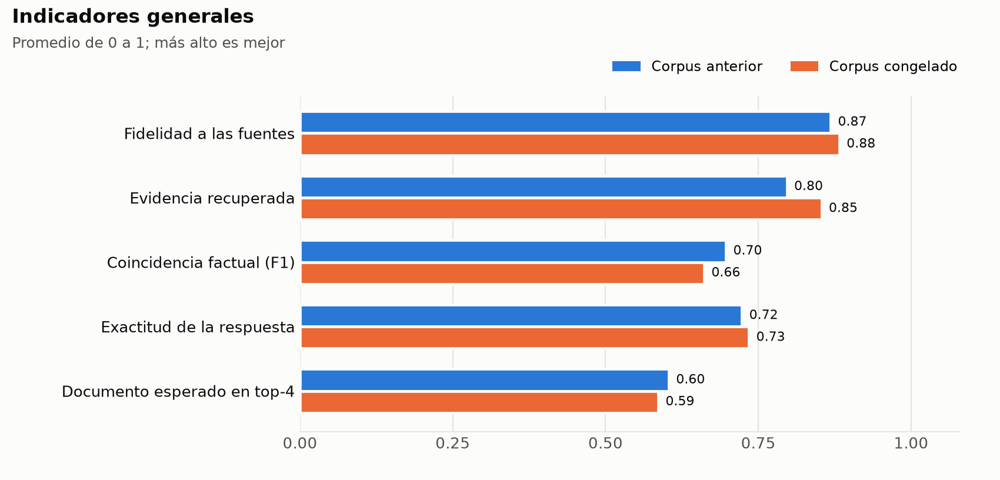
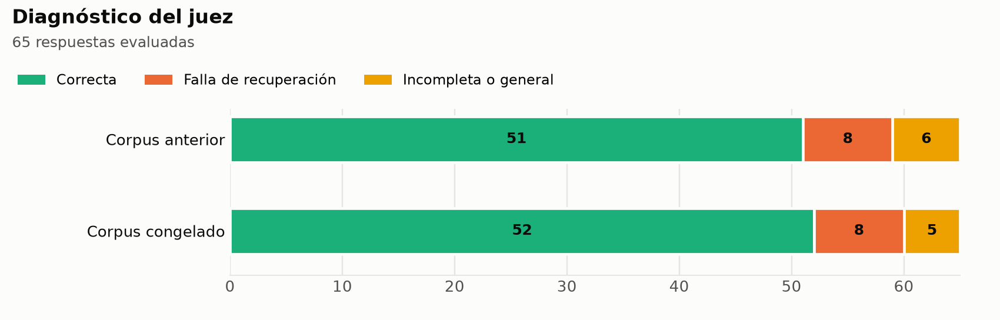
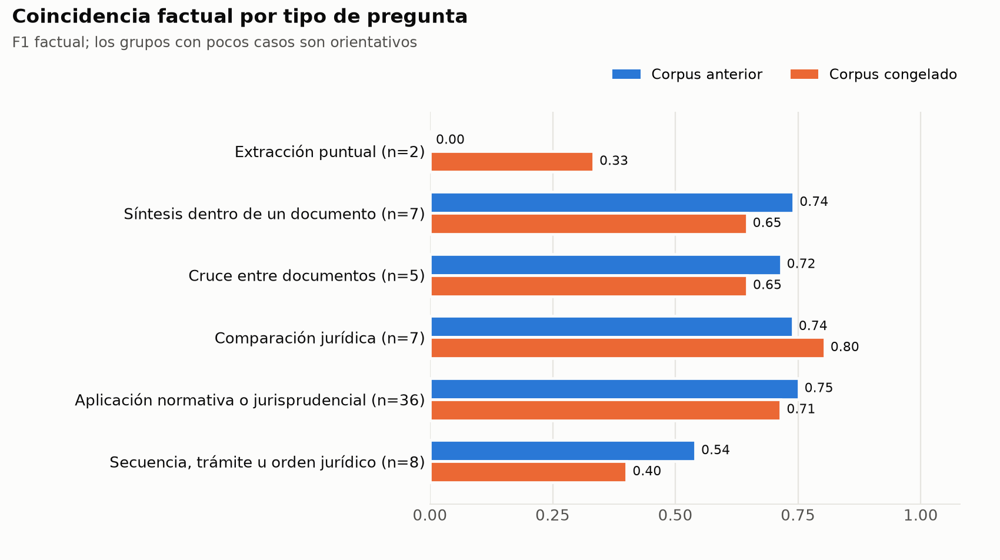
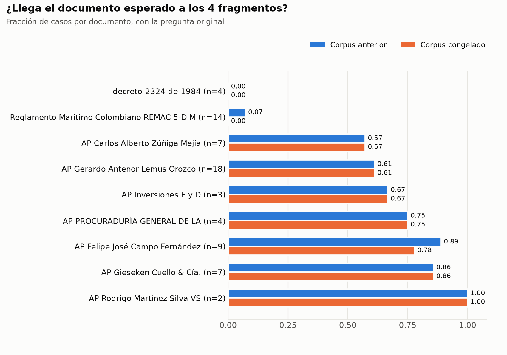

# `evaluation/` — Evaluación offline del RAG

Infraestructura offline para medir la calidad de ATLAS. Nunca forma parte de la ruta de servicio: ningún módulo de `api/` o `core/` la importa (ver [`docs/ARCHITECTURE.md` § 10](../docs/ARCHITECTURE.md#10-evaluación-offline-evaluation)).

## Contenido

| Archivo | Qué hace |
|---|---|
| `ground_truth.py` | Carga y valida `data/legal-ground-truth-v0.1.json` (21 casos) |
| `ground_truth_v02.py` | Construye `data/legal-ground-truth-v0.2.json` desde el Excel (66 casos, con tipo, `revisado` y documentos esperados por título) y lo valida |
| `metricas_sin_llm.py` | **Métricas fijas sin LLM** que se corren siempre: recuperación (documento, artículo exacto, diversidad, fuga territorial) y respuesta (citas, referencias sin respaldo), con IC 95 %, desgloses y comparación con la línea base |
| `retrieval_baseline.py` | Línea base, fase 1: recuperación por documento esperado (hit@k, MRR), sin LLM |
| `generation_cache.py` | Línea base, fase 2: grafo real una vez por caso, con ruta, consulta reescrita, tokens y costo, en caché reanudable |
| `ragas_v02.py` | Línea base, fase 4: métricas RAGAS (`collections`) con juez gpt-5-nano sobre la caché |
| `baseline_report.py` | Línea base, fase 5: tablas consolidadas |
| `indexar_gold_local.py` | Indexa `data/documents/gold` en un ChromaDB de evaluación con la lógica de producción, sin S3 ni tocar el índice desplegado |
| `run_paths.py` | Rutas de resultados por corrida (`--tag`), para comparar modelos sin sobrescribir la línea base |
| `registro.py` | Registro versionado de evaluaciones (`registro/evaluaciones.csv` → `docs/REGISTRO_EVALUACIONES.md`) |
| `registro/evaluaciones.csv` | Registro de cada evaluación: fecha, versión del sistema, modelo, métricas, latencia y costo (versionado) |
| `ragas_common.py` | Lógica compartida: generación con el grafo real, dataset RAGAS, métricas y reporte reproducible |
| `ragas_eval_gemma.py` | Adaptador con juez Gemini/Gemma: `context_precision`, `context_recall`, `faithfulness`, `answer_relevancy` |
| `ragas_eval_ollama.py` | Adaptador con juez Ollama: `answer_relevancy` |
| `citation_coverage.py` | Diagnóstico offline de cobertura de citas en las respuestas |
| `rrf_diagnostic.py` | Diagnóstico offline de la fusión RRF del retriever híbrido |
| `data/legal-ground-truth-v0.1.json` | Dataset jurídico v0.1 (21 casos) |
| `data/legal-ground-truth-v0.2.xlsx` | Dataset jurídico v0.2 construido por el equipo jurídico (fuente) |
| `data/legal-ground-truth-v0.2.json` | Dataset v0.2 versionado, generado por `ground_truth_v02.py` (66 casos) |
| `data/linea-base-sin-llm-v0.2.json` | Línea base versionada de las métricas sin LLM (global, IC 95 % y valor por caso) |
| `results/` | Reportes de cada corrida (no versionados, ver `.gitignore`) |

Comandos, variables de entorno y forma del reporte: [`docs/SCRIPTS.md` § Evaluación del RAG](../docs/SCRIPTS.md#evaluación-del-rag).

## Métricas fijas sin LLM

Se corren **siempre** que se cambie la ingesta, el retriever o los prompts
(`make eval-sin-llm`, ~20 s). No usan gpt-5-nano ni ningún otro modelo
generador o juez: 0 tokens, y la misma entrada da exactamente el mismo
resultado (ver [Verificación](#verificación-de-las-métricas)). Comparan
contra lo que escribió el equipo jurídico en el ground truth v0.2 (documento
esperado, respuesta y `ubicacion_evidencia`).

Cada corrida deja dos archivos en `results/`: `metricas-sin-llm-v0.2.json`
(todo, con el detalle por caso) y `metricas-sin-llm-v0.2.md` (tablas para
leer o pegar en un informe).

### Qué se mide

**Recuperación con la pregunta original** (corre el retriever de producción):

| Métrica | Qué mide | Cómo leerla |
|---|---|---|
| `acierto_doc_4` | El documento esperado está entre los **4 fragmentos que llegan al modelo** | Más alto es mejor. Es la métrica principal de recuperación |
| `acierto_doc_20` | El documento esperado está en el top-20 | Si es alto y `acierto_doc_4` bajo, el documento está pero mal ordenado |
| `mrr_doc_20` | Inverso de la posición del documento esperado en el top-20 | Sube si el documento correcto se acerca al top-4 aunque aún no entre |
| `doc_recall_4` | Fracción de los documentos esperados en los 4 fragmentos (10 casos esperan dos) | Más alto es mejor |
| `articulos_4` | Fracción de los artículos (`5.3.6.2`) y normas con número y año (`Ley 768 de 2002`) que cita el equipo jurídico y que aparecen en el texto de esos 4 fragmentos | Mide si llega el **artículo exacto**, no solo el documento |
| `docs_distintos_4` | Documentos distintos entre los 4 fragmentos (1 a 4) | Informativa. Muy bajo indica que un solo documento acapara el contexto |
| `fuga_territorial_4` | Fracción de casos donde llega una norma **local** (Cartagena, Santa Marta, Turbo) de un lugar que la pregunta no menciona | Más bajo es mejor. Debería tender a 0 |

**Grafo completo** (sobre una caché de `generation_cache.py` ya existente: no
genera respuestas nuevas):

| Métrica | Qué mide | Cómo leerla |
|---|---|---|
| `acierto_doc_4_grafo` | Como `acierto_doc_4`, con los fragmentos que recuperó el grafo con la **consulta enriquecida** | Comparada con `acierto_doc_4` dice si el enriquecimiento ayuda o estorba |
| `articulos_4_grafo` | Como `articulos_4`, con esos mismos fragmentos | Más alto es mejor |
| `citas_validas` | El validador de producción acepta las citas `[docN]` de la respuesta | Debe ser 1. Si baja, se rompió el formato de citas |
| `respuestas_con_refs_sin_respaldo` | Respuestas que citan una norma o artículo que no está en ningún fragmento ni en la pregunta | Más bajo es mejor. Es la señal más directa de una referencia inventada |
| `refs_esperadas_en_respuesta` | Fracción de las referencias del equipo jurídico que la respuesta menciona | Más alto es mejor |

### Cómo leer el reporte

- **Intervalo de confianza (IC 95 %).** Cada valor global trae un intervalo
  por bootstrap (2000 remuestreos, semilla fija, así que también es
  reproducible). Con 58 casos el intervalo de `acierto_doc_4` mide unos
  ±0,12: una diferencia global menor que eso no se puede distinguir del azar
  de qué preguntas tiene el dataset.
- **Desgloses.** Por tipo de pregunta, por `revisado` y por clase del
  documento esperado (`jurisprudencia`, `normativa`, `mixta`,
  `sin documento`).
- **Comparación con la línea base.** Si existe
  [`data/linea-base-sin-llm-v0.2.json`](data/linea-base-sin-llm-v0.2.json)
  (versionada), cada corrida se compara contra ella caso por caso. `Estado`:

  | Estado | Significa | Qué hacer |
  |---|---|---|
  | `igual` | Ningún caso cambió (o los cambios se compensan) | Nada |
  | `peor_en_margen` / `mejor_en_margen` | Cambiaron casos, pero el global sigue dentro del IC 95 % de la línea base | Es un cambio **real** del sistema (todo es determinista): revisar los casos listados. No se puede afirmar que generalice |
  | `regresion` / `mejora` | El global sale del IC 95 % en esa dirección | Una regresión no se acepta sin explicarla |

  La consola imprime `REGRESIÓN frente a la línea base: …` y
  `Empeora dentro del margen (revisar casos): …`; el `.md` lista los casos
  por id en «Casos a revisar».
- **Ruido conocido de ChromaDB.** La búsqueda vectorial de ChromaDB es
  aproximada (HNSW) y el índice se carga distinto en cada arranque del
  servidor: con los mismos datos, el orden de algún caso puede cambiar entre
  reinicios (dentro de una misma sesión es estable). Medido en 9 corridas
  completas tras reiniciar ChromaDB: solo cambia `registro-058` en `mrr_doc_20` (posición 4 o 6 del documento
  esperado, ±0,002 en el global); el resto de métricas es idéntico. Ese caso
  está en `inestables` de la línea base y sus cambios se reportan aparte, sin
  contar. Afecta igual al ChromaDB de AWS; no es un error de las métricas.
- **Actualizar la línea base.** Cuando un cambio se acepta,
  `uv run python -m evaluation.metricas_sin_llm --guardar-linea-base` y se
  versiona el JSON en el mismo commit (los `inestables` se conservan).

### Qué no miden

Si la respuesta es jurídicamente correcta. Eso solo lo dice el juez RAGAS
(`ragas_v02.py`), que se reserva para los hitos. Dos comprobaciones lo
muestran:

- En la línea base, el juez califica casi igual las respuestas con y sin el
  documento esperado (*answer accuracy* 0,71 frente a 0,70), porque otros
  documentos pueden respaldar la respuesta.
- Con la caché del modelo local `gemma4:e2b`, que el juez calificó mucho peor
  (32 de 65 respuestas correctas frente a 51), estas métricas no muestran
  ninguna regresión: `acierto_doc_4_grafo` 0,579 y
  `respuestas_con_refs_sin_respaldo` 0,015 (`mejor_en_margen`); solo
  `refs_esperadas_en_respuesta` baja dentro del margen (0,058). El modelo
  local no inventa más referencias ni recupera peor; lo que falla es la
  redacción de la respuesta, y eso solo lo ve el juez.

Estas métricas miden otra cosa: si el sistema llega a las **mismas fuentes**
que usa el equipo jurídico y si cita algo que no tiene respaldo.

**Límites:** el cruce es por título y por texto exacto; `articulos_4` y las
referencias solo aplican a los casos que citan artículos jerárquicos o normas
con número y año (39 de 66). Los artículos cortos ("artículo 15") se ignoran
porque son ambiguos entre normas.

### Línea base de estas métricas

Corpus congelado (`data/documents/gold`, 5.862 fragmentos), ChromaDB 1.3.5 y
`embeddinggemma` locales, caché de gpt-5-nano del 2026-11-01. Es el contenido de
`data/linea-base-sin-llm-v0.2.json`; entre paréntesis, la línea base anterior.

| Métrica | Valor | IC 95 % | Casos |
|---|---|---|---|
| `acierto_doc_4` | 0,586 (0,603) | 0,45 – 0,71 | 58 |
| `acierto_doc_20` | 0,741 (0,741) | 0,62 – 0,84 | 58 |
| `mrr_doc_20` | 0,562 (0,556) | 0,44 – 0,68 | 58 |
| `doc_recall_4` | 0,509 (0,534) | 0,39 – 0,62 | 58 |
| `articulos_4` | 0,075 (0,071) | 0,01 – 0,16 | 39 |
| `docs_distintos_4` | 2,30 (2,27) | 2,03 – 2,58 | 66 |
| `fuga_territorial_4` | 0,045, 3 casos (0,061, 4 casos) | 0,00 – 0,11 | 66 |
| `acierto_doc_4_grafo` | 0,544 (0,561) | 0,40 – 0,67 | 57 |
| `articulos_4_grafo` | 0,136 (0,129) | 0,05 – 0,24 | 38 |
| `citas_validas` | 1,000 (1,000) | 1,00 – 1,00 | 65 |
| `respuestas_con_refs_sin_respaldo` | 0,000 (0,046, 3 casos) | 0,00 – 0,00 | 65 |
| `refs_esperadas_en_respuesta` | 0,079 (0,090) | 0,01 – 0,16 | 38 |

Todos los cambios quedan dentro del margen de la línea base anterior.

Lo que muestran los desgloses:

- **La normativa es el punto débil.** Con documento esperado de normativa
  (REMAC 5, Decreto 2324 de 1984), `acierto_doc_4` es 0 de 18 (antes 1 de 18);
  con jurisprudencia, 34 de 40 (0,850). Las 3 fugas territoriales caen en esos
  casos: en lugar de la norma nacional llega un reglamento local.
- **Los casos revisados por el equipo jurídico** son casi todos de normativa
  (18 de los 19 que tienen documento esperado): `acierto_doc_4` 0,053 frente a
  0,846 en los no revisados. La diferencia por revisión es la misma que la de
  normativa frente a jurisprudencia.
- **El artículo exacto casi nunca llega** (`articulos_4` 0,075), aunque
  llegue el documento.
- **La consulta enriquecida no mejora la recuperación** frente a la pregunta
  original (`acierto_doc_4_grafo` 0,544 frente a `acierto_doc_4` 0,586,
  dentro del margen), pero sí trae más artículos exactos (0,136 frente a
  0,075) y lleva la normativa de 0 a 2 de 18.

`acierto_doc_4` (0,586) es la tasa de los fragmentos que llegan al modelo. El
`hit_at_4` de `retrieval_baseline.py` (0,603) se calcula sobre el ranking de
20 y por eso es distinto.

### Verificación de las métricas

Comprobado el 2026-10-28 con ChromaDB y Ollama locales:

- **Determinismo.** Corridas repetidas en la misma sesión de ChromaDB dan
  Δ = 0 en las 12 métricas; entre reinicios, solo el caso inestable de arriba.
- **Detectan cambios reales.** Se perturbó el retriever a propósito y se
  comparó contra la línea base:

  | Cambio provocado | Lo que reporta |
  |---|---|
  | Ninguno | todo `igual` |
  | 2 fragmentos en vez de 4 | `peor_en_margen` en `acierto_doc_4` (0,569), `doc_recall_4` y `articulos_4`; `mejor_en_margen` en `fuga_territorial_4` |
  | 8 fragmentos en vez de 4 | `mejor_en_margen` en `acierto_doc_4` (0,638) y `doc_recall_4`; `mejora` en `articulos_4` (0,154) |
  | Solo BM25 (sin búsqueda vectorial) | `peor_en_margen` en `mrr_doc_20` (0,477) y `articulos_4`; `acierto_doc_4` igual |
  | Ranking invertido (sistema roto) | **`regresion`** en `mrr_doc_20` (0,304); `peor_en_margen` en `acierto_doc_4` (0,483), `doc_recall_4`, `articulos_4` y `fuga_territorial_4` |

- **Valores correctos.** Revisados a mano contra el texto: las 3 referencias
  sin respaldo (003 cita el Decreto 2324 de 1984, 045 el artículo 5.3.2.5 y
  052 el 5.3.3.3, y ninguno aparece en sus fragmentos ni en la pregunta) y las
  4 fugas (005 y 008 reciben el reglamento de Cartagena sin mencionarla; 013
  es de Cartagena y recibe la zonificación de Santa Marta; 015 es de El
  Rodadero y recibe el de Cartagena).
- **Pruebas unitarias.** 41 en `tests/unit/test_metricas_sin_llm.py`,
  incluida la línea de comandos de punta a punta (guardar línea base,
  detectar una regresión, conservar los inestables). Se probaron con 21
  mutaciones del código (invertir un signo, quitar un filtro, cambiar un
  percentil…): las pruebas fallan con las 21.

## Resultados sobre el ground truth v0.2

**Línea base vigente: corpus congelado, 2026-11-01.** 66 casos construidos por el equipo jurídico, 27 marcados como revisados. Detalle de cada corrida en el [registro de evaluaciones](../docs/REGISTRO_EVALUACIONES.md).

| Indicador | Corpus congelado (vigente) | Corpus anterior (2026-10-08) | Modelo local gemma4:e2b (2026-10-14) |
|---|---|---|---|
| Fragmentos indexados | **5.862** | 5.888 | — |
| Respuestas correctas según el juez | **52 de 65** | 51 de 65 | 32 de 65 |
| Falla de recuperación / incompleta | **8 / 5** | 8 / 6 | — |
| Fidelidad a las fuentes (*faithfulness*) | **0,88** | 0,87 | 0,83 |
| Evidencia recuperada (*context recall*) | **0,85** | 0,80 | 0,82 |
| Factual F1 / Answer Accuracy | **0,66 / 0,73** | 0,70 / 0,72 | 0,41 / 0,59 |
| Documento esperado en los fragmentos del grafo (hit@4) | **0,53** (normativa 2 de 18) | 0,55 (normativa 2 de 18) | 0,57 |
| Tipo de pregunta más débil | Secuencia, trámite u orden jurídico (F1 **0,40**) | Secuencia, trámite u orden jurídico (F1 0,54) | — |

**Lectura:** depurar el corpus no cambió de forma medible la calidad. La diferencia emparejada por caso, ahora menos antes, incluye el cero en las cuatro métricas: fidelidad +0,01 (IC 95 % −0,03 a +0,06), evidencia recuperada +0,06 (−0,01 a +0,13), Factual F1 −0,04 (−0,11 a +0,04) y Answer Accuracy +0,01 (−0,05 a +0,07). Entre una corrida y otra, 17 de 65 casos cambian de diagnóstico aunque el total casi no se mueve, así que la nota de un caso aislado no es concluyente. Las notas son del juez automático, no una validación jurídica.

### Qué hay que trabajar

1. **La normativa no llega al modelo.** Con la pregunta original, REMAC 5 (14 casos) y Decreto 2324 de 1984 (4 casos) quedan en 0 de 18 dentro de los 4 fragmentos. Ambos están en el corpus (573 y 239 fragmentos), así que el problema es de recuperación, no de datos. La jurisprudencia llega en 34 de 40.
2. **Las preguntas de secuencia o trámite son las más débiles** (F1 0,40, 8 casos): la respuesta omite etapas. Con tan pocos casos, la caída frente a 0,54 es orientativa.
3. **Falso fuera de alcance:** el caso 046 sigue sin responderse porque el grafo lo clasifica como `out_of_scope`.
4. **Texto de plantilla:** 4 respuestas filtran instrucciones internas ("oraciones con [doc"), igual que en la corrida anterior.
5. **Citas:** ninguna respuesta trae referencias sin respaldo (antes 3) y todas las citas son válidas, pero las referencias esperadas casi no aparecen (0,079).

### Condiciones de la corrida

- **Método:** el de [`docs/EVALUACION_LINEA_BASE.md`](../docs/EVALUACION_LINEA_BASE.md) § 2, sin cambios: ground truth con el mismo hash, recuperación, caché de generación, piloto de 3 casos con revisión manual, RAGAS 0.4.3 con juez gpt-5-nano (`reasoning_effort=low`) y reporte. 65 casos juzgados, sin errores ni valores faltantes.
- **Corpus:** `data/documents/gold` de `main` @ `23c6c5b`, 56 archivos, 5.862 fragmentos (4.404 de jurisprudencia y 1.458 de normativa), sha256 `98e8bba6…c3cf52`. Se verificó el índice contra Gold: 0 faltantes y 0 sobrantes.
- **Sistema:** backend sin cambios (`4c2186e`) y gpt-5-nano como generador.
- **Infraestructura local, no AWS:** ChromaDB 1.3.5 y Ollama en CPU, indexados con [`indexar_gold_local.py`](indexar_gold_local.py). **La colección que sirve ATLAS en AWS (`rag_playas`) no se actualizó**, así que todavía sirve el corpus anterior. Por eso la latencia (39,0 s frente a 60,7 s) no es comparable y no es efecto del corpus.
- **Interrupción:** un reinicio del equipo detuvo el juez en el caso 33. Se reanudó desde ahí sin repetir casos.
- **Control de ceros (§ 10):** Factual Correctness se repitió dos veces en los 3 casos con cero. Caso 003: 0 → 0,57 → 0, respuesta incompleta e inestable. Caso 062: 0 → 0 → 0, fallo real, porque no entrega el radicado aunque el documento llega. Caso 070: 0 → 0,60 → 0,46, cero falso del juez.
- **Costo estimado:** generación 0,22 USD, juez 0,47 USD y control 0,01 USD, ≈0,70 USD en total.
- **No incluido:** el exportador de snapshots de `origin/corpus` (`c642d09`) no cambia Gold y no está en `main`. `feat/ingesta-medallion-escalabilidad` y `security` tampoco entran, y el frontend no interviene en esta evaluación.
- **Por verificar antes de reindexar AWS:** `build_or_load_vectorstore` crea la colección sin indicar la métrica, y ChromaDB usa `l2` por defecto, mientras que la colección anterior y esta corrida usan coseno. No se midió su efecto.

### Prueba en AWS con Claude (no reemplaza la línea base)

Corrida del 2026-11-01 sobre el ChromaDB y el Ollama de AWS, para dejar lista la evaluación en la misma infraestructura de la corrida anterior. Sin una key de OpenAI válida no se pudo usar gpt-5-nano, así que se usó **Claude Sonnet 5.5 como generador y Claude Haiku 5.5 como juez**. La línea base vigente sigue siendo la de gpt-5-nano de arriba.

**Las notas del juez no son comparables con la línea base**, porque cambian a la vez el generador y el juez, y no se separó el efecto de cada uno. Este juez fue mucho más severo en el piloto y en la corrida completa; los números de abajo no indican que ATLAS haya empeorado.

| Indicador | Prueba con Claude en AWS |
|---|---|
| Respondidas | 65 de 66 (el caso 046 pide aclaración) |
| Diagnóstico del juez | 14 correctas, 38 recuperación, 11 incompletas, 2 alucinación |
| Fidelidad / evidencia recuperada | 0,63 / 0,39 |
| Factual F1 / Answer Accuracy | 0,30 / 0,22 |

Sí se puede usar lo que no depende del juez:

| Métrica sin LLM | AWS, prueba | Local, línea base |
|---|---:|---:|
| `acierto_doc_4` (pregunta original) | 0,569 | 0,586 |
| `acierto_doc_20` | 0,741 | 0,741 |
| `mrr_doc_20` | 0,561 | 0,562 |
| Normativa en top-4 | 0 de 18 | 0 de 18 |
| Jurisprudencia en top-4 | 33 de 40 | 34 de 40 |
| `articulos_4_grafo` | 0,202 | 0,136 |
| `refs_esperadas_en_respuesta` | 0,202 | 0,079 |
| `respuestas_con_refs_sin_respaldo` | 0,123 (8 casos) | 0,000 |

- **Recuperación:** AWS confirma el hallazgo principal: la normativa no llega al modelo. La diferencia con local es de un caso de jurisprudencia y está dentro del margen. No se investigó su causa.
- **Generador:** Sonnet citó más referencias esperadas, pero también dejó 8 respuestas con referencias sin respaldo. La regresión es de este generador, no del sistema con gpt-5-nano.
- **Texto de plantilla:** ninguna respuesta lo filtró, frente a 4 con gpt-5-nano.
- **Colección:** el corpus congelado quedó en AWS en una colección aparte, `rag_playas_corpus_congelado` (5.862 fragmentos, coseno). `rag_playas` sigue con 5.888 y ATLAS no se cambió a la nueva.
- **Vectores:** se copiaron del índice local, porque generarlos en el Ollama de AWS tomaba unas 3 horas. Se compararon antes en 24 fragmentos, incluidos los 10 más largos: coseno ≥ 0,99998 frente a los del Ollama de AWS. Las preguntas sí se convierten en vectores en AWS.
- **Modelos:** Claude se conectó con un puente local no versionado, sin cambios en el backend. Ignora la temperatura y `reasoning_effort`, y la latencia (26,1 s) no es comparable. El control de ceros se repitió en el caso 056: 0 → 0,18 → 0,06.
- **Pendiente:** repetir generación y juez con gpt-5-nano sobre esta colección cuando haya key. Es lo único que deja una línea base en las mismas condiciones que la anterior.

### Gráficas

Las cifras de cada gráfica están en las tablas de esta sección y en las dos de abajo.

#### Por tipo de pregunta

| Tipo | Casos | F1 antes | F1 ahora | Answer Accuracy antes | Answer Accuracy ahora |
|---|---:|---:|---:|---:|---:|
| Extracción puntual | 2 | 0,00 | 0,33 | 0,25 | 0,50 |
| Síntesis dentro de un documento | 7 | 0,74 | 0,65 | 0,75 | 0,71 |
| Cruce entre documentos | 5 | 0,72 | 0,65 | 0,65 | 0,60 |
| Comparación jurídica | 7 | 0,74 | 0,80 | 0,54 | 0,57 |
| Aplicación normativa o jurisprudencial | 36 | 0,75 | 0,71 | 0,83 | 0,85 |
| Secuencia, trámite u orden jurídico | 8 | 0,54 | 0,40 | 0,56 | 0,53 |

#### Por documento esperado

Fracción de casos en que el documento llega a los 4 fragmentos, con la pregunta original.

| Documento | Casos | Antes | Ahora |
|---|---:|---:|---:|
| decreto-2324-de-1984 | 4 | 0,00 | 0,00 |
| Reglamento Maritimo Colombiano REMAC 5-DIMAR (202103) | 14 | 0,07 | 0,00 |
| AP  Carlos Alberto Zúñiga Mejía y otros VS DIMAR y otros | 7 | 0,57 | 0,57 |
| AP Gerardo Antenor Lemus Orozco VS Distrito de Santa Mata y  | 18 | 0,61 | 0,61 |
| AP Inversiones E y D S.A.S VS DIMAR y otros | 3 | 0,67 | 0,67 |
| AP PROCURADURÍA GENERAL DE LA ANCIÓN VS COORPAMAG Y OTROS | 4 | 0,75 | 0,75 |
| AP Felipe José Campo Fernández VS Corpamag y otros | 9 | 0,89 | 0,78 |
| AP Gieseken Cuello & Cía. S. en C. VS DIMAR y otros | 7 | 0,86 | 0,86 |
| AP Rodrigo Martínez Silva VS Minambiente y otros | 2 | 1,00 | 1,00 |

- Comparación frente al modelo local, sobre el corpus anterior: **[`docs/INFORME_EVALUACION_ATLAS.md`](../docs/INFORME_EVALUACION_ATLAS.md)**.
- Cómo leer las métricas, con el detalle de la corrida anterior: **[`docs/EVALUACION_LINEA_BASE.md`](../docs/EVALUACION_LINEA_BASE.md)**.
- Comandos: [`docs/SCRIPTS.md` § Línea base](../docs/SCRIPTS.md#línea-base-sobre-legal-ground-truth-v02).
